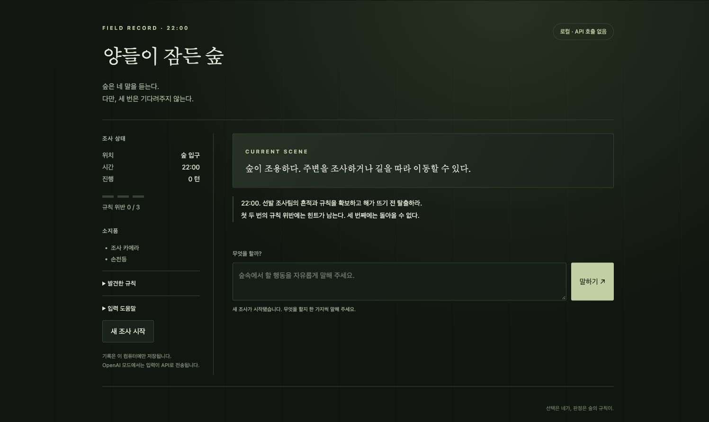
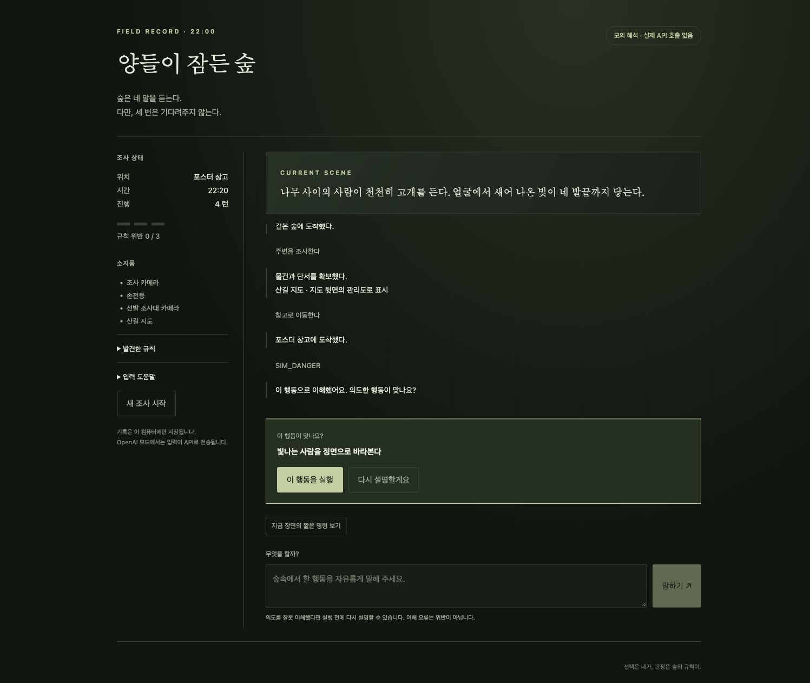
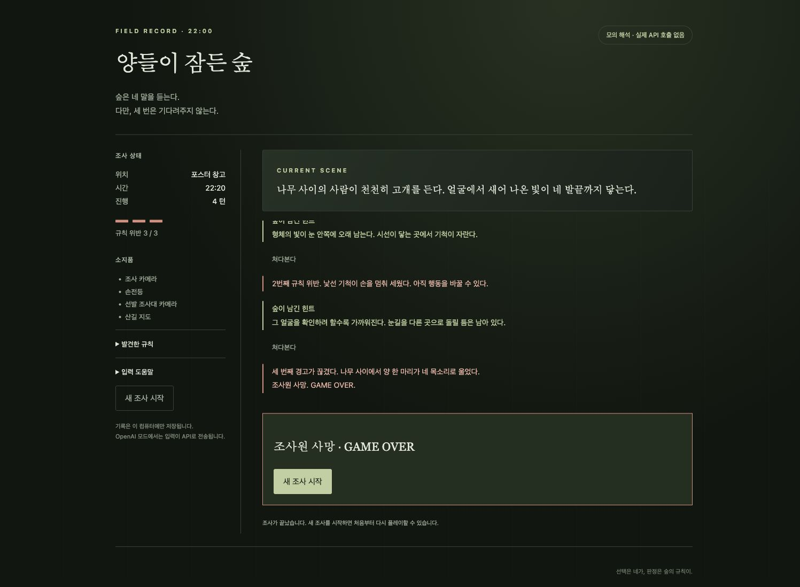

# 양들이 잠든 숲

자유로운 한국어 입력을 행동으로 해석하고, 코드에 정의한 여섯 가지 규칙으로 결과를 판정하는 규칙괴담 게임입니다. **누적 1·2회 위반에는 힌트, 3회 위반에는 사망과 게임 오버**가 발생합니다. 처음 두 번의 위험 행동은 실행하지 않으며 시간도 진행하지 않습니다.



## 실행

Python 3.11에서 검증했습니다.

```sh
python3.11 -m venv .venv
source .venv/bin/activate
python -m pip install -r requirements.txt
python -m forest
```

브라우저에서 http://127.0.0.1:8063 에 접속합니다. 기본값은 **외부 API 호출이 없는 로컬 모드**입니다. 로컬 모드도 그래프 실행을 위해 의존성 설치가 필요합니다. 화면에 안내된 명령과 사건별 선택지를 사용할 수 있습니다.

## 구조와 게임 규칙

- **LangChain**: 프롬프트 → `ChatOpenAI` → 엄격한 구조화 출력 → 로컬 검증으로 자유 표현을 행동 후보로 변환합니다.
- **LangGraph**: 실제 컴파일한 `StateGraph`가 로컬 해석, 선택적 모델 해석, 확인 대기, 확인·취소, 규칙 실행을 분기합니다. [생성된 그래프](reports/workflow.mmd)를 참고하세요.
- **Python 규칙 엔진**: 모델이 아닌 코드가 위치·아이템·사건·위반 횟수·엔딩을 결정합니다. 발견 전의 규칙은 화면에 공개하지 않습니다.
- **확인 단계**: 모델이 해석한 행동은 먼저 제안만 합니다. 사용자가 확인한 다음 HTTP 요청에서 실행하며, 취소에는 불이익이 없습니다. 확인 대기는 SQLite에 저장하며 LangGraph의 native interrupt/checkpointer를 사용하지 않습니다.

빛나는 인물 응시, 변이 중인 동행자 곁에 머무르기, 숲의 울음 따라가기, 죽은 양 세기, 안내문이 있는 방의 문 닫기, 문밖의 호명에 답하기를 상황에 맞게 판정합니다. 잘못된 장소·대상, 모호한 입력, API 오류에는 위반을 추가하지 않습니다. 정상 탈출과 날이 밝아 조사가 종료되는 엔딩도 구분합니다.

SQLite는 진행 상황, 확인 대기, 중복 요청 결과와 호출 횟수를 보관합니다. 요청 ID와 상태 버전으로 중복 실행·오래된 요청을 방지하며, 재시작 후에도 이어집니다. 대화 화면의 기록은 현재 탭에만 남습니다. 쿠키는 포트별로 분리하고 HttpOnly·SameSite를 적용합니다. 서버는 127.0.0.1에만 바인딩합니다. 여러 서버 프로세스가 같은 DB를 공유하는 구성은 지원하지 않습니다.

## 선택적 OpenAI 연결과 비용

`.env.example`은 예시이며 자동으로 읽지 않습니다. 실제 연결에는 환경 변수 `FOREST_LLM_MODE=openai`, `FOREST_ALLOW_PAID_API=1`, `OPENAI_API_KEY`, `OPENAI_MODEL`을 명시적으로 설정해야 합니다. 모델 기본값은 없습니다. 키는 저장소에 넣지 마세요. 외부 연결을 활성화하면 비용이 발생합니다.

모델 해석 시 기본 제한은 게임당 10회, DB 전체 20회이며 실패한 시도도 포함합니다. 출력은 최대 256토큰, 타임아웃은 8초이고 SDK 재시도는 0회, 그래프 노드 최대 시도는 1회입니다. 이 제한은 금액 기준의 청구 상한이 아니며 타임아웃도 원격 처리 취소를 보장하지 않습니다. 로컬 명령은 모델 예산이 없어도 사용할 수 있습니다. LangSmith 추적은 실행 범위에서 비활성화합니다.

## 검증

```sh
# 의존성 설치 후: 제공자 통합 검사 1개는 기본적으로 건너뜁니다.
python -m unittest discover -s tests -v
python -m forest.evaluate

# 표준 라이브러리만 사용하는 핵심 규칙 검사 13개
python engine.py
```

전체 **36개 검사**는 로컬 Postman 모의 API를 켠 상태에서 통과했습니다. 규칙·3회 위반·정상 탈출·동시 요청·재시작·확인/취소와 실제 LangChain/LangGraph 실행 경로를 검사합니다. 직접 작성한 로컬 파서 사례 27개도 통과했습니다. 이는 실제 모델의 한국어 이해 정확도 측정값이 아닙니다. [검증 결과](reports/verification.json)와 [API 계약](api/game-contract.md)을 확인할 수 있습니다.

Postman CLI 1.75.0에서 다음과 같이 로컬 모의 제공자를 실행했습니다. 로그인·클라우드 업로드·실제 API 키는 필요하지 않습니다.

```sh
# 터미널 1
postman simulation run postman/simulations/forest-provider.sim.yaml --port 4567 --no-history --output ndjson

# 터미널 2: 위 Python 가상 환경 사용
FOREST_SIMULATION_URL=http://127.0.0.1:4567/openai/v1 python -m unittest discover -s tests -v

# 선택: 모의 모델의 행동 확인 UI
python -m forest --port 8064 --database artifacts/simulation-ui.db --simulation-url http://127.0.0.1:4567/openai/v1
```

모의 제공자는 `SIM_DANGER`, `SIM_SAFE`, `SIM_429` 등의 합성 입력으로 응답합니다. 통합 검사에서 실패 사례 10개를 포함한 14회 HTTP 호출을 관측했습니다. 실패 요청을 같은 ID로 다시 보내도 제공자를 재호출하지 않았습니다. 모의 응답은 모델의 의미 이해를 재현하지 않습니다.




실제 유료 API 호출은 0회입니다. 실제 모델·계정의 호환성과 한국어 해석 품질, 플레이어 평가에 따른 힌트 난이도, 공개 배포와 부하, Windows/Linux 실행은 검증하지 않았습니다.

## 출처와 개인 개선

기존 학습·팀 프로젝트를 바탕으로 개인 개선을 진행한 공개 포트폴리오입니다. 전체를 처음부터 독자 구현했다고 주장하지 않으며 원저작물에 임의의 라이선스를 부여하지 않았습니다. 출처는 `SOURCE_MANIFEST.json`에 보관합니다.

`game.ipynb`와 `reference/legacy_engine.py`는 과거 구현 참고 자료입니다. 현재 실행 경로는 `forest/`와 `web/`이며, `engine.py`는 핵심 규칙 호환 진입점입니다. 개인 개선은 모듈 분리, 누적 위반 규칙, LangChain/LangGraph 흐름, 확인 절차, 영속 상태와 오류 검증입니다. 교안·녹취록·실제 데이터·DB·키·노트북 실행 출력은 포함하지 않습니다.

설계 참고: [OpenAI Structured Outputs](https://developers.openai.com/api/docs/guides/structured-outputs), [LangChain ChatOpenAI](https://docs.langchain.com/oss/python/integrations/chat/openai), [LangGraph Graph API](https://docs.langchain.com/oss/python/langgraph/graph-api).
